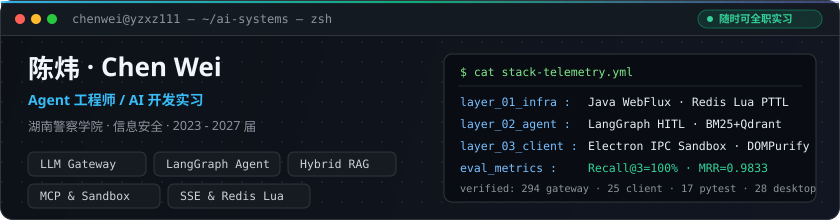
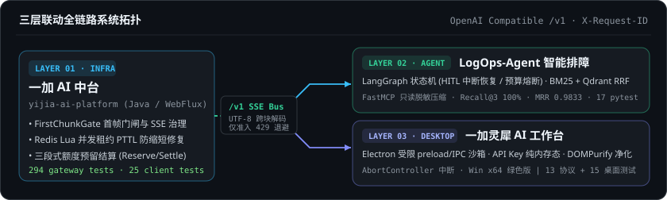

 

**[交互式技术简历主页 (yzxz111.github.io)](https://yzxz111.github.io)** · **[2166136579@qq.com](mailto:2166136579@qq.com)** · **求职意向：Agent 工程师 / AI 开发实习**

 

---

### 工程方向与聚焦

湖南警察学院信息安全专业 2023 级本科生（2027 届，可随时全职到岗）。相比单纯调用 Prompt 或拼装单层 Demo，我更关注 **“网关底座稳定性 → Agent 编排与可观测 → 桌面工作台体验”** 的三层协作：

- **网关与流式治理**：在 Spring Boot WebFlux 中落地 `FirstChunkGate` 首帧门闸与 SSE 心跳保活，处理 UTF-8 跨块解码、准入 429 有限退避防重复计费，并修复 Redis Lua 共享并发集合 `PTTL` 缩短缺陷。
- **Agent 编排与混合 RAG**：使用 LangGraph 构建异常取证、相关性评估与人工确认（HITL）中断恢复状态机；结合 BM25 + Qdrant RRF 输出 Citation 溯源，通过只读 FastMCP 工具封装防路径穿越校验与堆栈脱敏压缩。
- **桌面工作台隔离与交互**：Electron 启用上下文隔离与沙箱并禁用渲染进程 Node.js，受限 `preload / IPC` 代理网络通信，API Key 仅驻留运行内存不落盘，Markdown 经 DOMPurify 净化渲染。

---

---

### 核心开源项目

| 层级 | 项目 | 核心技术栈 | 可验证工程指标 | 仓库 |
|---|---|---|---|---|
| **01 · 底座网关** | **一加 AI 中台** | `Java` `Spring Boot WebFlux` `Redis Lua` `PostgreSQL` `Vue 3` | OpenAPI 3.1 · SSE 跨块 & 防重复计费 · Lua `PTTL` 修复 · **294 网关回归 + 25 客户端测试** | [yijia-ai-platform](https://github.com/yzxz111/yijia-ai-platform) |
| **02 · 智能体** | **LogOps-Agent** | `Python` `FastAPI` `LangGraph` `Qdrant` `BM25` `FastMCP` | HITL 挂起恢复 · 25 手册/125 块 RRF · 只读脱敏压缩 · **Recall@3 100% / MRR 0.9833 / 17 pytest** | [logops-agent](https://github.com/yzxz111/logops-agent) |
| **03 · 桌面端** | **一加灵犀** | `Electron` `React` `Vite` `DOMPurify` `Playwright` | 受限 IPC 沙箱 · 内存态 Key · `AbortController` 取消 · **Win x64 打包 + 13 协议 + 15 桌面测试** | [yijia-lingxi](https://github.com/yzxz111/yijia-lingxi) |
| **并发调度** | **BatchFlow** | `Java` `Spring JDBC` `PostgreSQL` `RabbitMQ` `Vue 3` | API/Worker 分离 · 租约与 Fencing Token 防脑裂写 · **前端 87 + 后端 33 + Compose 验收** | [batchflow](https://github.com/yzxz111/batchflow) |

---

> 更多交互式链路演练、Eval 评测可视化与一键投递摘要，见 **[https://yzxz111.github.io](https://yzxz111.github.io)**
