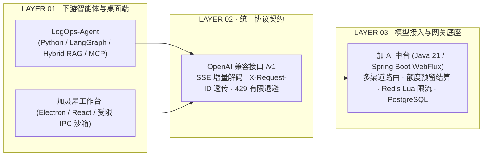

# 👋 你好，我是 陈炜 (`@yzxz111`)

**湖南警察学院 · 信息安全（2023 - 2027 届） · 可随时全职到岗**

💼 正在寻找 **Agent 工程师 / AI 开发实习 / AI 安全研发实习** 机会

🌐 [在线交互式简历主页](https://yzxz111.github.io) · 📧 [2166136579@qq.com](mailto:2166136579@qq.com)

> *从模型网关底座到智能体编排与安全桌面端，打造可验证、可观测、有安全边界的 AI 工程系统。*

 

---

### 💡 关于我

你好，我是 **陈炜**，湖南警察学院信息安全专业 2023 级本科生（2027 届），专注于 **AI Agent 工程化、大模型网关基础设施与系统安全**。

- 🔗 **全链路 AI 工程闭环**：独立构建「模型网关（`yijia-ai-platform`）→ Agent 排障应用（`logops-agent`）→ 桌面工作台（`yijia-lingxi`）」，打通 OpenAPI 3.1 契约、SSE 流式传输与 `X-Request-ID` 链路追踪。
- 🤖 **Agent 编排与混合 RAG**：基于 LangGraph 实现异常提取、多路取证、相关性评估与人工确认（HITL）中断恢复状态机；结合 BM25 + Qdrant RRF 混合检索、Query 改写与 Citation 引用溯源。
- 🛡️ **信息安全 × AI 工程实践**：将安全思维深度融入 AI 系统——FastMCP 只读封装（路径穿越校验 + 堆栈敏感脱敏）、Electron 受限 preload / IPC 沙箱与内存态密钥管理、DOMPurify 渲染净化。
- ⚡ **高可靠流式网关治理**：在 Java 21 Spring Boot WebFlux 中实现 UTF-8 跨块 SSE 解析、429 准入有限退避防重复计费，并定位修复 Redis Lua 共享并发集合 TTL 被短租约缩短的并发缺陷。
- 🧪 **评测驱动与自动化验证**：坚持以离线 Eval 评测集（Recall@K / MRR）、pytest / Vitest / Playwright 与 GitHub Actions CI 保障工程交付质量。

---

### 🏗️ 自研 AI 全链路联动架构

---

### 🚀 核心开源项目

| 项目名称 | 定位与技术栈 | 核心工程亮点与实测验证 | 仓库 |
|---|---|---|---|
| **LogOps-Agent** | 智能排障 Agent 后端 `Python 3.11` `FastAPI` `LangGraph` `Qdrant` `BM25` `FastMCP` | 状态机编排 + HITL 中断恢复 + 步数/Token 熔断；BM25 + Qdrant RRF 混合检索与只读 MCP 取证；30 条评测集 **Recall@3 100%**、**MRR 0.9833**、**17/17 pytest 通过** | [yzxz111/logops-agent](https://github.com/yzxz111/logops-agent) |
| **一加 AI 中台** | 多租户大模型网关与管理平台 `Java 21` `WebFlux` `R2DBC` `Redis Lua` `PostgreSQL` `Vue 3` | OpenAPI 3.1 契约；WebFlux UTF-8 跨块 SSE 与准入 429 退避防重计费；修复 Redis Lua 并发租约 TTL 缺陷；**294 项网关回归 + 25 项协议测试** | [yzxz111/yijia-ai-platform](https://github.com/yzxz111/yijia-ai-platform) |
| **一加灵犀** | AI 桌面工作台客户端 `Electron` `React` `Vite` `DOMPurify` `Playwright` | 多轮 SSE 流式对话与 `AbortController` 即时中断；受限 preload / IPC 沙箱与密钥纯内存驻留；Windows x64 免安装分发 + **13 项协议与 15 项桌面交互验证** | [yzxz111/yijia-lingxi](https://github.com/yzxz111/yijia-lingxi) |
| **BatchFlow** | 批量 CSV 导入与任务调度平台 `Java 21` `Spring Boot` `Spring JDBC` `PostgreSQL` `RabbitMQ` `Vue 3` | API 与 Worker 进程分离；同事务批次入库 + 检查点推进；租约与 Fencing Token 防过期 Worker 写入；**前端 87/87 + 后端 33/33 + Compose 验收通过** | [yzxz111/batchflow](https://github.com/yzxz111/batchflow) |

---

### 💼 求职信息

| 项目 | 说明 |
|---|---|
| **意向岗位** | Agent 工程师实习 / AI 应用开发实习 / 大模型安全与工程实习 |
| **学历背景** | 湖南警察学院 · 信息安全 · 本科在读（2023.09 - 2027.06） |
| **到岗时间** | **随时可全职到岗**（可连续实习 6 个月以上） |
| **在线主页** | [https://yzxz111.github.io](https://yzxz111.github.io) |
| **联系邮箱** | `2166136579@qq.com` |
